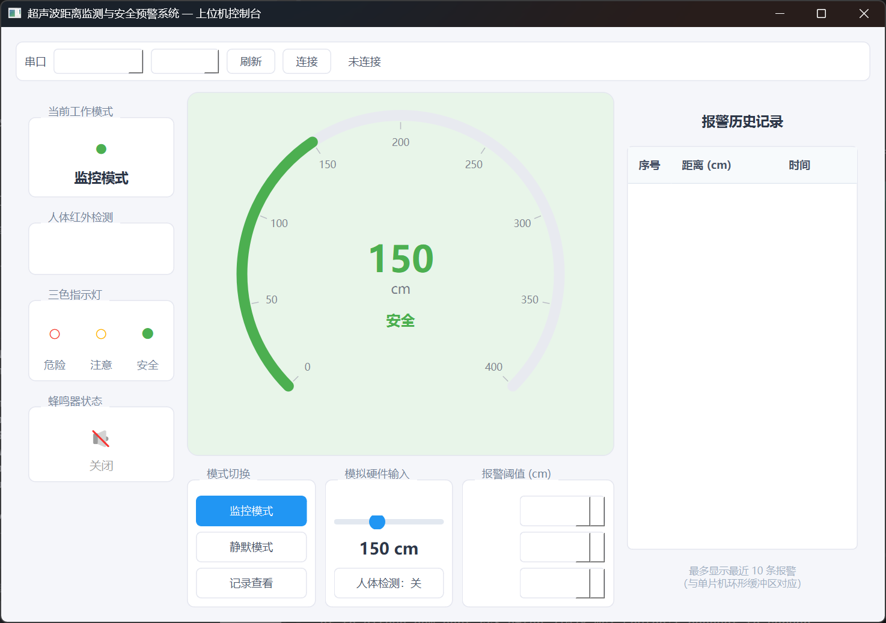
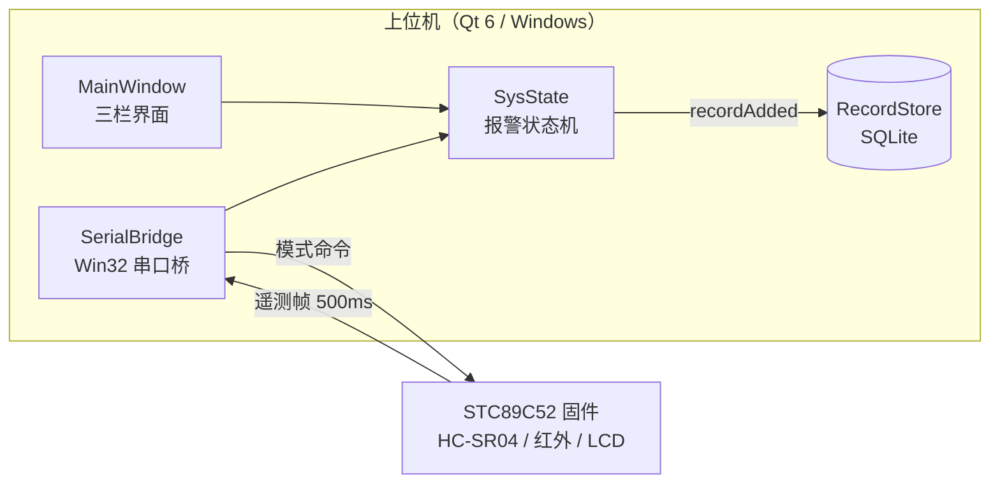

# 超声波距离监测与安全预警系统 — Qt 上位机


为 STC89C52 超声波距离报警装置设计的桌面监控端。通过自定义串口协议与下位机双向通信，实时可视化四级报警状态机，并将报警事件持久化到 SQLite。



## 功能特性

- **圆形仪表盘**：QPainter 自绘 270° 弧形量程（0~400cm），随报警等级自动变色
- **四级报警状态机**：安全 → 注意 → 报警 → 强制报警（有人靠近），与单片机固件逻辑逐行对应
- **三色 LED / 蜂鸣器节拍模拟**：普通报警 1.2s 慢闪，强制报警 400ms 快闪，静默模式只亮不响
- **串口双向通信**：500ms 遥测帧解析 + 模式切换命令下发，拔线自动断开
- **SQLite 持久化**：报警事件全量落盘，重启后自动恢复最近 10 条
- **三种工作模式**：监控 / 静默 / 记录查看，与单片机按键循环切换保持同步
- **单元测试**：11 个 QTest 用例覆盖阈值边界与状态机行为

## 系统架构



数据流是单向闭环：控件修改状态 → 状态机评估并发信号 → 界面只负责渲染。`SysState` 只依赖 QtCore，不包含任何界面代码，因此可以脱离 GUI 做单元测试。

## 串口协议

纯 ASCII 文本帧，以 `\r\n` 结尾，9600-8-N-1：

| 方向 | 帧格式 | 说明 |
|------|--------|------|
| 单片机 → 上位机 | `DIST:142,HUMAN:0,MODE:0` | 每 500ms 一帧遥测 |
| 上位机 → 单片机 | `CMD:MODE:1` | 界面切换模式时下发（0/1/2） |

解析层容错：字段缺失或非法值计入 BAD 帧，不中断后续解析；缓冲区上限 1KB 防垃圾流。

## 构建与运行

```powershell
# 环境：Qt 6.8 + MinGW 13（qmake 工程）
cd dist
qmake ../ChaoShenBo.pro
mingw32-make -j4
.\release\ChaoShenBo.exe
```

不插硬件也能跑：界面内置模拟输入（距离滑块 + 人体红外开关），可直接演示全部报警行为。

## 运行测试

```powershell
cd dist\tests
qmake ../../tests/tests.pro
mingw32-make -j4
.\systate_test.exe
# Totals: 11 passed, 0 failed — 29ms
```

覆盖用例：四级阈值边界、**持续报警 100 拍只记 1 条（上升沿触发）**、强制报警优先级、静默模式、阈值钳位不变量、环形缓冲容量、启动恢复。

## 技术亮点

**1. 弧线与刻度对不上的坐标系问题**
`QPainter::drawArc` 的角度约定（0° 在 3 点钟、逆时针、单位 1/16 度）与屏幕坐标（y 轴向下）方向相反，直接混用会导致弧线与刻度左右镜像。修复方式是把弧线、刻度、数值标签统一到同一套参数化公式 `(cx + r·cosθ, cy − r·sinθ)`，改量程只需动一个常数。

**2. 报警记录刷屏**
原逻辑每 50ms 评估一次就落一条记录，报警期间 0.5 秒填满环形缓冲。改为**等级上升沿触发**——只在从非报警进入报警的时刻记录一次，"一次报警事件一条记录"。

**3. 渲染去重**
状态未变化时跳过 `setStyleSheet` 和表格重建（每帧重解析全局样式表的代价很高），界面刷新从"每 50ms 全量重画"降为"变化时增量更新"。

**4. 无 QSerialPort 依赖的串口实现**
QtSerialPort 模块未安装时，用 Win32 API（`CreateFile` + 非阻塞 `ReadFile` + 20ms 轮询）实现了等效功能——QSerialPort 底层本就是这套 API，行为一致且零新增依赖。

## 目录结构

```
├── ChaoShenBo.pro          # qmake 工程文件
├── main.cpp                # 入口
├── mainwindow.h/.cpp       # 主窗口（三栏布局 + 串口栏）
├── systate.h/.cpp          # 报警状态机（纯 QtCore，可独立测试）
├── distancewidget.h/.cpp   # 圆形仪表盘自绘控件
├── serialbridge.h/.cpp     # Win32 串口桥（协议解析）
├── recordstore.h/.cpp      # SQLite 持久化层
├── styles.qss              # 界面样式
├── tests/                  # QTest 单元测试
└── docs/                   # 技术报告、答辩稿、简历描述
```

## 文档

- [项目技术报告](docs/项目技术报告.md) — 完整的设计与实现细节
- [答辩口播稿](docs/答辩汇报口播稿.md) — 项目演示与讲解流程
- [简历描述](docs/项目简历描述.txt) — 一段话版本
